# Paradise

A Leanback-based Android TV app for browsing movies and TV series, powered by [The Movie Database (TMDB)](https://www.themoviedb.org/) API.

[](https://github.com/halilozel1903/AndroidTVMovieParadise/actions/workflows/android.yml)
[](https://developer.android.com/tv)
[](app/build.gradle)
[](app/build.gradle)
[](LICENSE)

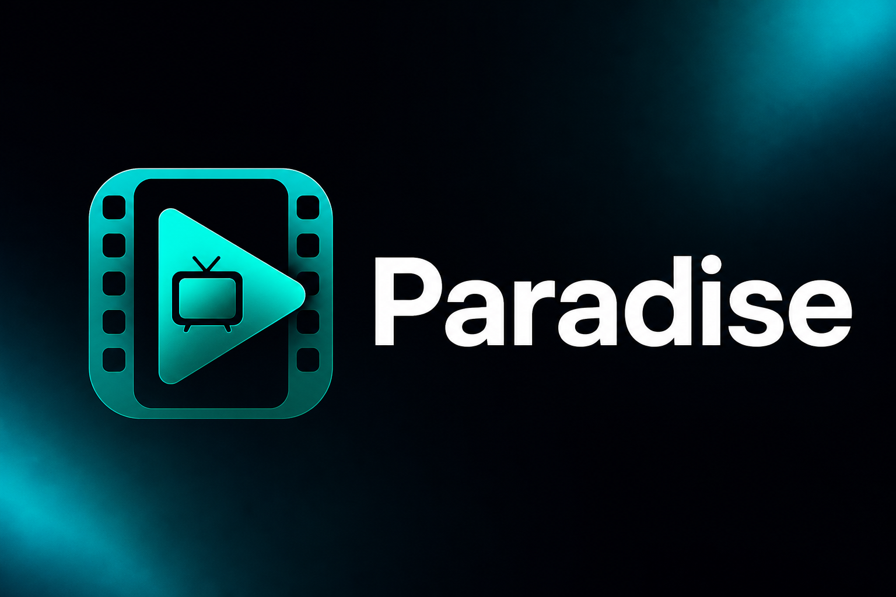

## Contents

- [Overview](#overview)
- [Features](#features)
- [Screenshots](#screenshots)
- [Tech stack](#tech-stack)
- [Architecture](#architecture)
- [Getting started](#getting-started)
- [Development](#development)
- [TMDB endpoints](#tmdb-endpoints)
- [Resources](#resources)
- [License](#license)

## Overview

Paradise is a remote-friendly catalogue for Android TV, Google TV and Android set-top boxes. It combines the AndroidX Leanback browse and details patterns with TMDB metadata: poster art, cast, genres, watch providers and trailers.

Everything is designed for the 10-foot UI: D-pad navigation, focus-driven scrolling, shared-element poster transitions, skeleton loading states and retryable error cards.

Background reading: [How to develop an Android TV app](https://halilozel1903.medium.com/how-to-develop-android-tv-app-5e251f3aa56b).

## Features

| Area | Details |
|------|---------|
| Home | Eight paginated rows (four movie, four TV) with endless horizontal scrolling and a backdrop that follows the focused title |
| Movies | Now Playing, Top Rated, Popular, Upcoming |
| TV series | On The Air, Airing Today, Popular, Top Rated |
| Search | Debounced movie search built on `SearchSupportFragment` |
| Details | Overview, rating, runtime, director, trailer action, genres, watch providers, cast and recommendations |
| Genres | Focusable genre chips that open a paginated movie grid |
| People | Biography, portrait and backdrop images, movie and series filmography |
| Trailers | YouTube embed in a WebView, with a hand-off to the YouTube app when the embed fails |
| States | Skeleton cards while loading, empty states, and retry cards on network errors |
| Focus | Leanback focus highlight (1.05× zoom and glow) on cards, outline-only selectors on chips |
| Localisation | English by default, Turkish (`values-tr`) included |

## Screenshots

### Home

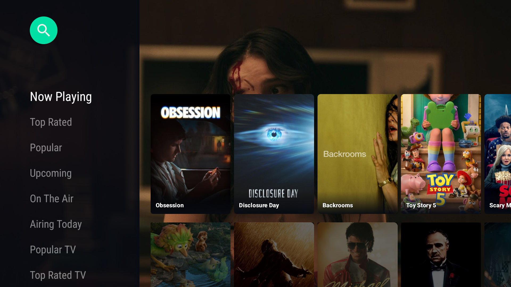

| Now Playing (focused) | Top Rated |
|---|---|
| 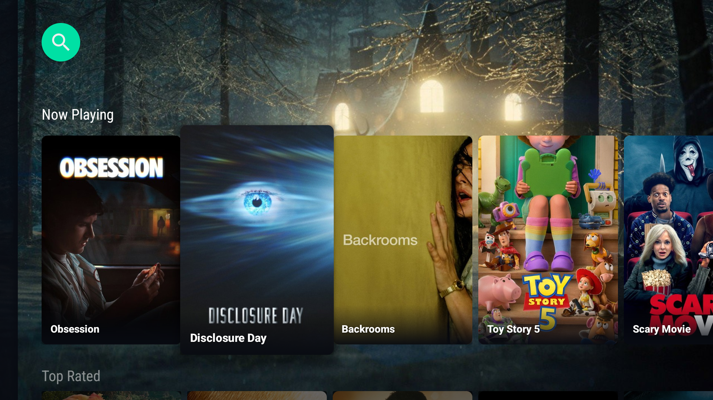 | 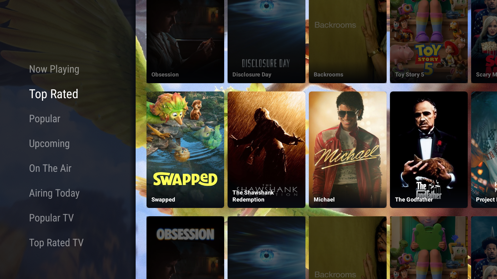 |

| Popular | Upcoming |
|---|---|
| 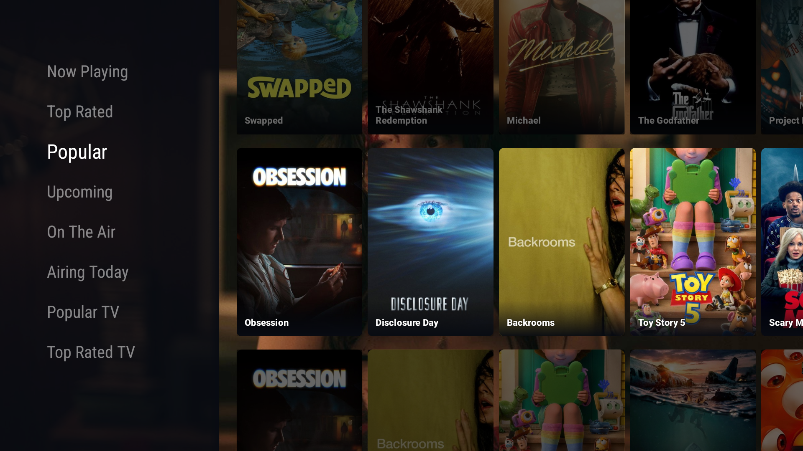 | 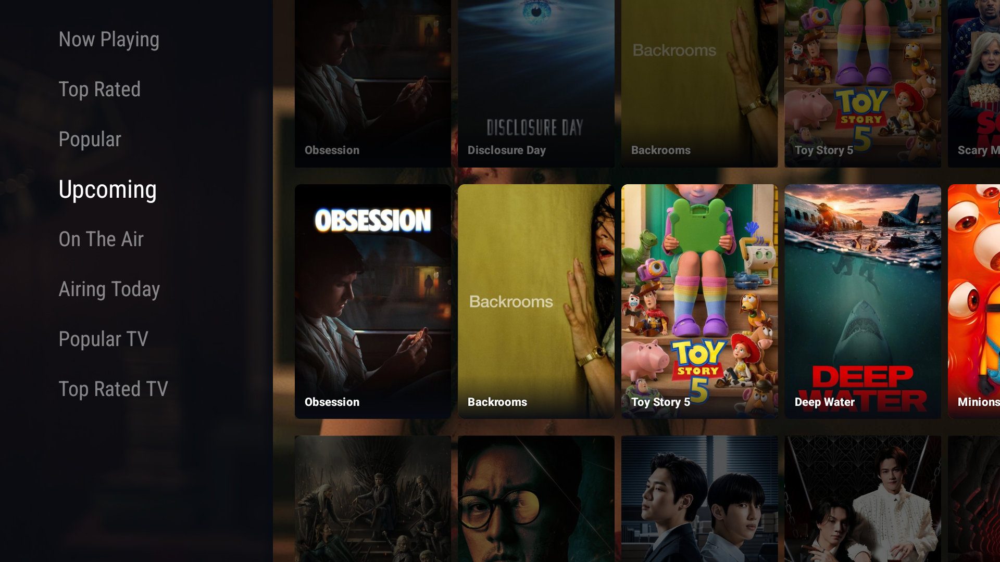 |

### Details

| Overview | Metadata and tags |
|---|---|
| 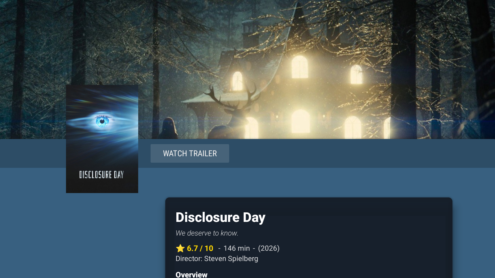 | 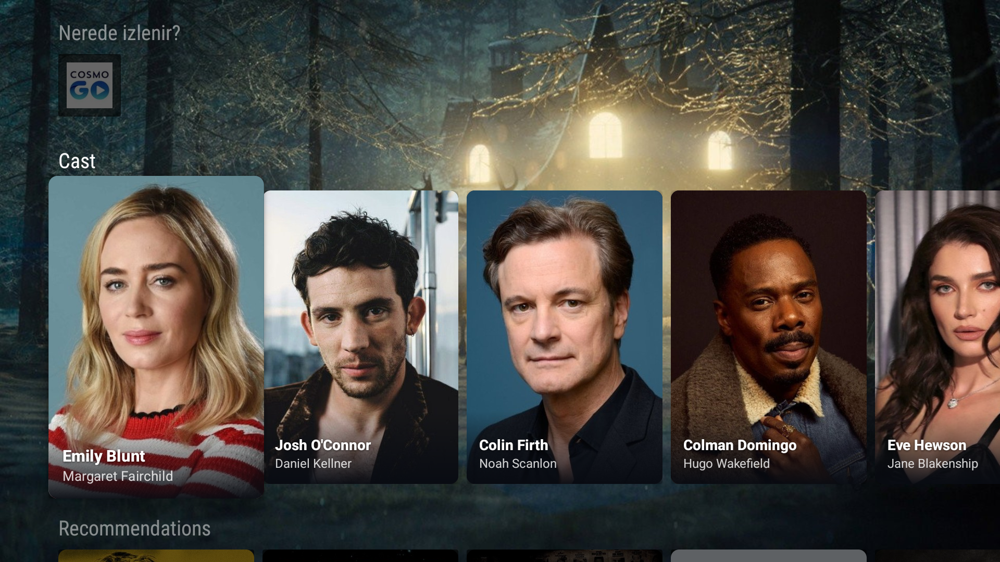 |

| Cast | Recommendations |
|---|---|
| 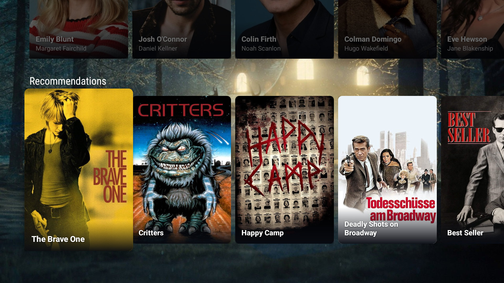 | 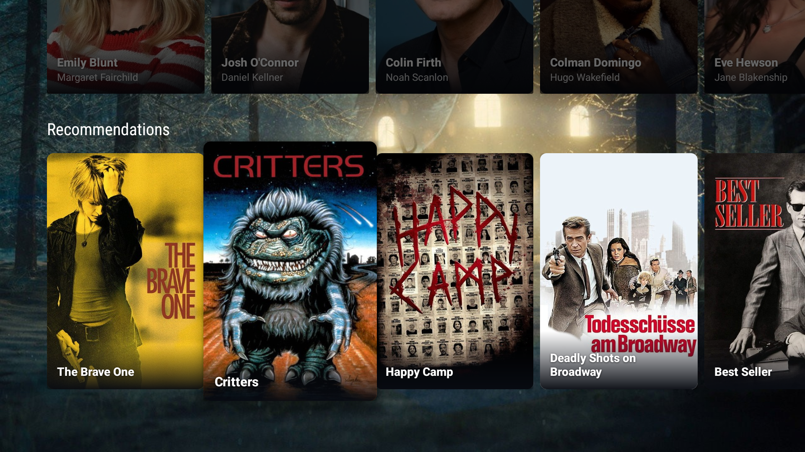 |

### Search

| Input | Results | Result detail |
|---|---|---|
| 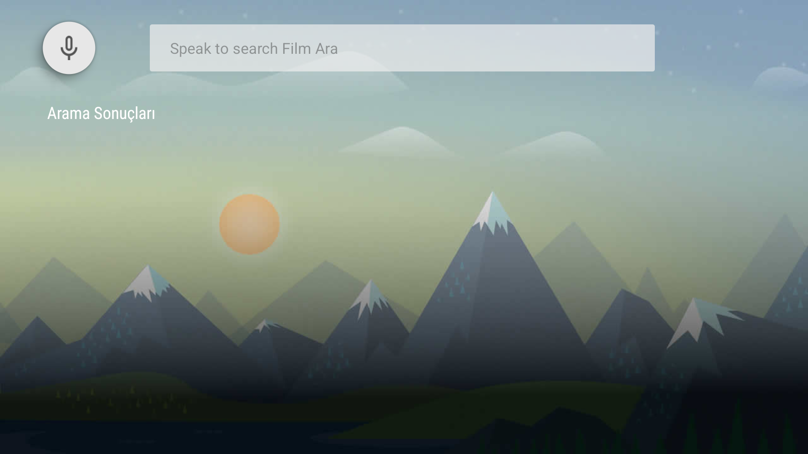 | 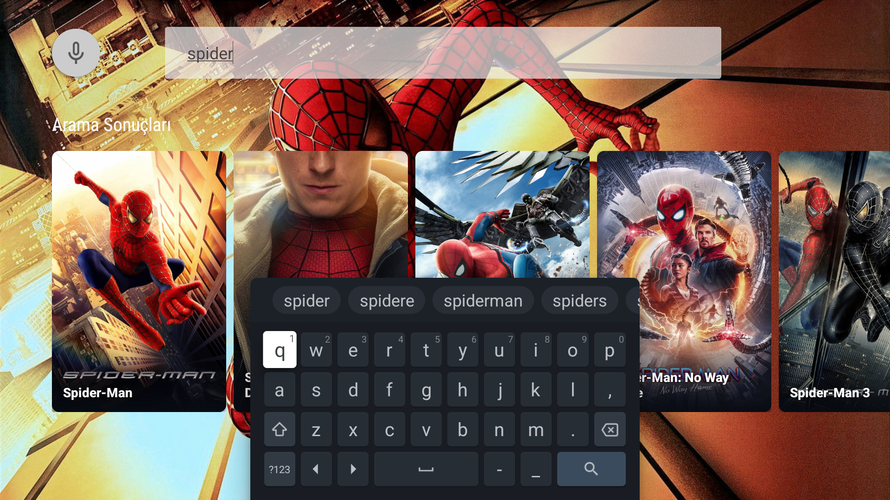 | 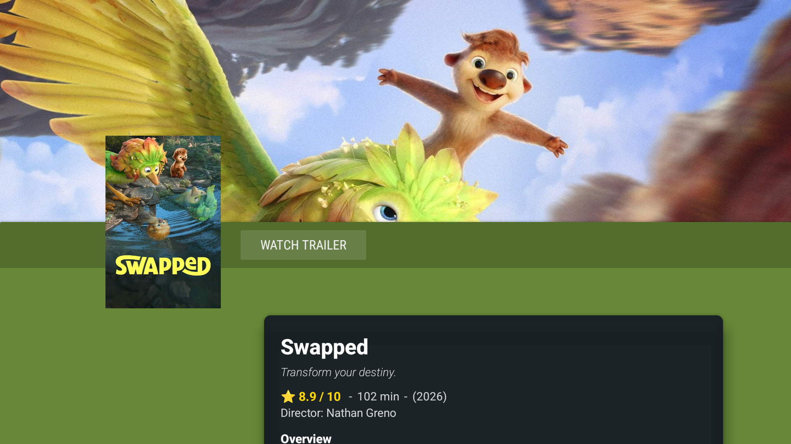 |

The screenshots are captured from an emulator by [`scripts/capture_screenshots.sh`](scripts/capture_screenshots.sh).

## Tech stack

| Layer | Libraries |
|-------|-----------|
| UI | AndroidX Leanback, AppCompat, CardView, Palette, Core SplashScreen |
| Networking | Retrofit 3, OkHttp 5, Gson |
| Async | RxJava 3, RxAndroid |
| Images | Glide 5 |
| Dependency injection | Dagger 2 |
| Playback | WebView (YouTube embed) with an external YouTube intent fallback |
| Build | Gradle 9.9, Android Gradle Plugin 9.5, version catalog (`gradle/libs.versions.toml`) |
| Language | Java 17 |

Every dependency resolves from Google Maven or Maven Central.

## Architecture

```
Activities            MainActivity · SearchActivity · MediaDetailActivity
                      PersonDetailActivity · GenreMoviesActivity · PlayerActivity
                                          │
Leanback fragments    MainFragment · SearchFragment · DetailFragment
                      TvDetailFragment · PersonDetailFragment · GenreMoviesFragment
                                          │
            ┌─────────────────────────────┼─────────────────────────────┐
     MVP presenters                 Row / card presenters          TheMovieDbAPI
  (Main, Search, Genre)          (Leanback Presenter classes)   (Retrofit + RxJava)
```

- **MVP** for the browse, search and genre flows (`MainContract`, `SearchContract`, `GenreMoviesContract`).
- **Leanback presenters** render rows, cards and chips; `RowLoadingHelper` swaps in skeleton, empty and error items.
- **Dagger** builds one application-wide graph (`ApplicationComponent`) that provides the HTTP client, the API and the presenters.
- **RxJava** disposables are released when a view goes away (`BaseRxPresenter`, fragment `onDestroy`).
- **`ApiKeyInterceptor`** attaches the TMDB key to every request, so API methods never handle it.

### Package layout

```
com.halil.ozel.movieparadise
├── dagger/          Application component and modules
├── data/
│   ├── api/         Retrofit service and API-key interceptor
│   └── models/      TMDB response models
└── ui/
    ├── base/        Base activity, focus helpers, Glide and Palette utilities
    ├── common/      Loading, empty and error cards
    ├── main/        Home rows and pagination
    ├── search/      Movie search
    ├── detail/      Movie detail, cast, tag rows, person detail, trailer lookup
    ├── tv/          TV series detail
    ├── genre/       Genre-filtered grid
    ├── movie/       Movie card presenter
    └── player/      Trailer player
```

### Focus handling

Focus behaviour follows the [Google TV focus guidelines](https://developer.android.com/design/ui/tv/guides/styles/focus-system):

- Poster cards use Leanback's `FocusHighlight.ZOOM_FACTOR_SMALL` with a neutral white glow.
- Genre and provider chips live in a `TagListRow` and use outline-only selector drawables, which avoids zoom flicker on small items.
- On the home screen, Back first returns to the row headers; a second press within two seconds exits the app.

## Getting started

### Requirements

- A recent Android Studio release that supports Android Gradle Plugin 9.5
- JDK 17 or newer
- Android SDK Platform 37 (the app compiles against 37 and targets 36)
- Optional: your own TMDB API key (v3 auth) from your [TMDB account settings](https://www.themoviedb.org/settings/api)

### 1. Clone

```bash
git clone https://github.com/halilozel1903/AndroidTVMovieParadise.git
cd AndroidTVMovieParadise
```

### 2. Use your own TMDB API key (optional)

A shared demo key is bundled in [`app/build.gradle`](app/build.gradle), so the app works straight after cloning. It is rate-limited and shared by everyone who builds the project, so use your own key for anything beyond trying the app out. Add it to `local.properties` in the project root (the file is git-ignored; see [`local.properties.example`](local.properties.example)):

```properties
TMDB_API_KEY=your_tmdb_v3_api_key
```

Alternatively, pass it as a Gradle property (`-PTMDB_API_KEY=...`) or as a `TMDB_API_KEY` environment variable. Any of these overrides the bundled key at build time.

### 3. Build and run

```bash
./gradlew assembleDebug
```

```bash
adb install -r app/build/outputs/apk/debug/app-debug.apk
```

Run it on an Android TV emulator or device; the app is listed under the Leanback launcher only.

## Development

| Task | Command |
|------|---------|
| Debug build | `./gradlew assembleDebug` |
| Unit tests | `./gradlew testDebugUnitTest` |
| Lint | `./gradlew lintDebug` |
| Release build (R8 + resource shrinking) | `./gradlew assembleRelease` |

The release build is minified and unsigned; add your own `signingConfig` before distributing it.

GitHub Actions runs the debug build, unit tests and lint on every push and pull request ([workflow](.github/workflows/android.yml)). An optional `TMDB_API_KEY` repository secret overrides the bundled key in CI builds.

### Project info

| | |
|---|---|
| Application ID | `com.halil.ozel.movieparadise` |
| Version | 1.6 (versionCode 6) |
| Min SDK | 24 (Android 7.0) |
| Target SDK | 36 |
| Compile SDK | 37 |

## TMDB endpoints

| Endpoint | Used for |
|----------|----------|
| `/movie/{list}` | Home rows: now playing, top rated, popular, upcoming |
| `/tv/{list}` | Home rows: on the air, airing today, popular, top rated |
| `/movie/{id}`, `/tv/{id}` | Details, credits, videos, recommendations, similar titles, watch providers |
| `/search/movie` | Search |
| `/discover/movie` | Genre grid |
| `/person/{id}` | Biography, images, movie and TV credits |

API reference: <https://developer.themoviedb.org/docs>

This product uses the TMDB API but is not endorsed or certified by TMDB.

## Resources

- [How to develop an Android TV app](https://halilozel1903.medium.com/how-to-develop-android-tv-app-5e251f3aa56b)
- [Android TV developer guide](https://developer.android.com/tv/)
- [Leanback library reference](https://developer.android.com/reference/androidx/leanback/package-summary)
- [Building an Android TV app](https://medium.com/@Marcus_fNk/building-an-android-tv-app-part-1-7f59b3747446)

## Support

If this project helped you, you can [buy me a coffee](https://www.buymeacoffee.com/halilozel1903).

## License

Released under the [MIT License](LICENSE). Copyright (c) 2023 Halil OZEL.
